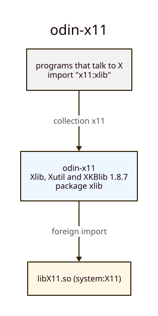

# Architecture: odin-x11

## Generation

`make generate` runs runic over `xlib/rune.yml` and `xtest/rune.yml`, each followed by
`scripts/postprocess.sh`. The headers are `/usr/include/X11` (libx11-dev, libxtst-dev), reached
through `build/sys`, which `scripts/generate.sh` fills with a link to `/usr/include`. The stubs in
`stdinc/` stand in for the C library's headers; `stdinc/stddef.h` gives `wchar_t`, which the
output takes from `core:c`. The output is committed, so consumers need neither runic nor the
headers to build.

`xtest/rune.yml` lists `X11/*` as extern and maps it to `x11:xlib`, as odin-gtk4's `gdkx` does,
so every Xlib type in `xtest` is `xlib`'s and `xtest` declares no Xlib symbol. `XInput.h`, under
`X11/extensions/`, is not extern: its `XDevice` and `XInputClassInfo` are declared in `xtest`
([DECISIONS §4](DECISIONS.md#4-one-package-a-shared-library)).

Two keys of Amber's runic fork shape the output:

- `detect.parameters: declared`: every pointer parameter is `^T` unless `arrays:` lists it.
  Xlib's parameters are unnamed in the prototypes, so the list names them `param0`, `param1`, …
- `evaluate_macros: true`: macros naming a built-in type are types; clang evaluates the rest
  with the headers included, so a cast to `Atom` resolves. A type macro in an extern header is
  that header's package's type: `xtest` writes `xlib.Bool`.

## Patches

Where runic's output is wrong for a caller, the fix is a row of the table in
`scripts/postprocess.sh`, listed in [PATCHED.md](PATCHED.md) and pinned in `xlib/patched.odin`
by a typed variable. A row that matches nothing fails `make generate`; a regeneration that drops
a fix fails to compile.

## Checks

| check | run by | fails when |
|---|---|---|
| `xlib/xlib_test.odin` | `make test` | a struct's size or a field's offset differs from C, a macro constant is not its value, a keysym call misbehaves |
| `xlib/coverage_test.odin` | `make test` | a procedure amber-canvas's `canvas_x11` calls is missing (it does not compile) |
| `xtest/xtest_test.odin` | `make test` | a constant is not its value, an Xlib type is declared in `xtest` instead of taken from `xlib`, `XDevice`'s layout differs from C |
| `xtest/coverage_test.odin` | `make test` | a procedure amber-canvas's `canvas_xtest` calls is missing (it does not compile) |
| `scripts/check-generated.sh` | `make lint` | a va_list procedure, a `[^]^T` out of the lists, a procedure runic could not type, a macro constant left as C text, a bound version (libX11, libXtst) that is not the installed one |
| `scripts/api.sh` | `make lint` | `docs/API.md` is stale |
| `scripts/cheatsheet.sh`, `scripts/cheatsheet-compile.sh` | `make lint` | the cheat sheet names something the API lacks, or a block does not compile |

## Collections

The collection `x11` points at this repo's root. `xtest` imports `x11:xlib`; the repo imports no
other binding.

